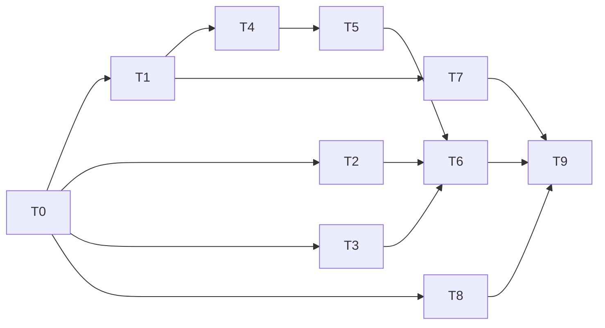

# 后续功能总任务表

来源：[设计](后续功能-design.md)。状态：☐未开始、◐进行中、☑完成；复杂度S/M/L，不设时间估计。

| 里程碑 | 内容 | 完成门槛 |
|---|---|---|
| M0 | 规格与契约 | 明确冻结值/缺失值，文件责任及软依赖边界 |
| M1 | 防御与交互 | 核心模块、偏转、帮助/详情、动画编译与服务端验证 |
| M2 | 完整战斗 | 37类插件、15炮塔、模式/状态/地形、资源和回归 |
| M3 | 联动生成 | AE2软依赖、外部输出、废弃基地及数据验证 |
| M4 | 交付 | 构建、服务端回归、旧存档、完成清单更新 |

| ID | 状态 | 任务 | 复杂度 | 依赖 | 验收与文件 |
|---|---|---|---|---|---|
| T0 | ☑ | 文档规格与API调查，冻结接口 | M | — | 设计、API证据；数值缺口已获用户授权 |
| T1 | ☑ | 核心模块与偏转护盾 | L | T0 | core/、核心BE、配置；旧库存与护盾测试 |
| T2 | ☑ | 独立帮助/详情页 | M | T0 | 新HTML/JS/CSS、UiNetwork桥；权限及状态测试 |
| T3 | ◐ | 炮管动画及近远静态切换 | L | T0 | client/、AimUpdates、模型；编译与网络门槛，图形待验 |
| T4 | ☑ | 37类插件、控制效果与可配默认值 | L | T1 | ModuleEffect、扩展配置、状态类、BE与注册；钩子回归 |
| T5 | ☑ | 十炮塔、T1–T5和地形/模式 | L | T4 | StatsTable、AttackBehavior、Combat、BE；逐类型行为验证 |
| T6 | ☑ | 资源、配方、语言、JEI整合 | L | T2/T3/T4/T5 | 注册、JSON、语言、JEI；全资源与原版引用验证 |
| T7 | ☑ | 容器扫描和AE2软联动 | L | T1 | core自动化、compat/、构建配置；断网与无AE2回退 |
| T8 | ☑ | 废弃基地自然生成 | M | T0 | worldgen/、结构NBT、战利品、配置；codec/模板验证 |
| T9 | ◐ | 回归、持久化、产物与清单 | L | T6/T7/T8 | GameTest、打包审核、记录；区分代码完成与未实测 |

关键路径为规格→核心→插件状态→炮塔行为→资源整合→回归。AE2与原生结构API研究分别在T7/T8前完成。风险与应对遵循设计文档；正式美术占位和客户端未启动属于用户确认的边界。

## 2026-10-15进度写回

T1/T2/T4–T8源码与服务端专项证据已接入，详情见[开发记录](后续功能开发记录.md)。T3代码和资源接入，真实旋转/近远切换画面待验；T9服务端42项、跨进程持久化、构建与打包审计通过，保留客户端验收。UI普通点击仍有客户端故障，T2的页面和服务端动作完成不代表客户端交互已验收，M4尚未完成。42项全套首轮41通过、1项压力旧断言失败；修正夹具后最终42/42通过，包含新增原版普通点击/右键/守恒断言。独立进程持久化seed/verify各1/1通过。AE2真实网络独立1项通过。当前不自动启动客户端。
